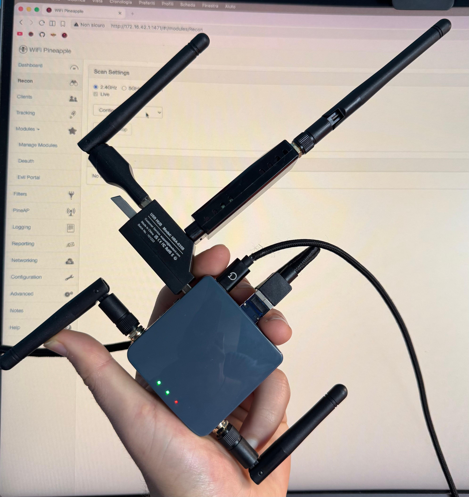
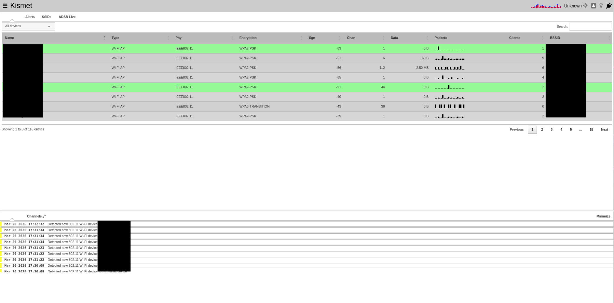

Ciao, sono Nicolò e studio Cybersecurity.

Ho deciso di sfruttare GitHub pages per condividere quello che studio e che sperimento.
In questo periodo sto studiando Crittografia, Malware Analysis e IoT, e il tempo per HTB non esiste più, comunque nel tempo libero e a mente spenta sto sviluppando un piccolo giochino 2D con pygame.

Qui gli ultimi push:

  <a href="/projects/Shadow_Apple/" style="text-decoration: none; color: inherit; text-align: center;">
    
    
Shadow Apple 🍎

  </a>

  <a href="/projects/Bruce/" style="text-decoration: none; color: inherit; text-align: center;">
    
    
Bruce 🦈

  </a>

  <a href="/notes/kismet" style="text-decoration: none; color: inherit; text-align: center;">
    
    
Kismet 📡

  </a>

---

### Link utili

<ul>
  <li><a href="https://protocol-explorer-alpha.vercel.app">Protocol Explorer</a></li>
  <li><a href="https://cryptohack.org/courses/">CryptoHack</a></li>
  <li><a href="https://cyberclash.io/">Cyberclash</a></li>
  <li><a href="https://www.acn.gov.it/portale/w/la-settimana-cibernetica-del-28-settembre-2025">Agenzia per la cybersicurezza nazionale</a></li>
</ul>

---

### Link personali

<ul>
  <li><a href="https://github.com/NicoFragale">GitHub</a></li>
  <li><a href="https://www.linkedin.com/in/nicol%C3%B2-mariano-fragale-302586233/">LinkedIn</a></li>
  <li><a href="https://www.youtube.com/@Range2200/videos">YouTube</a></li>
  <li><a href="https://profile.hackthebox.com/profile/019dbc2a-91d5-722e-a8a1-a41b67af3ee8?utm_medium=copy_url">Hack The Box</a></li>
</ul>