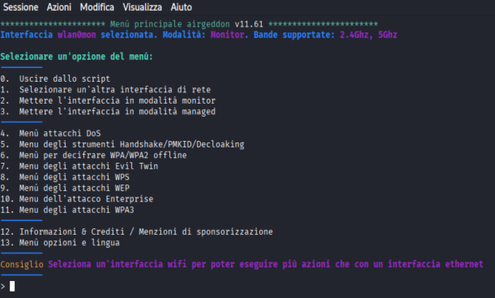
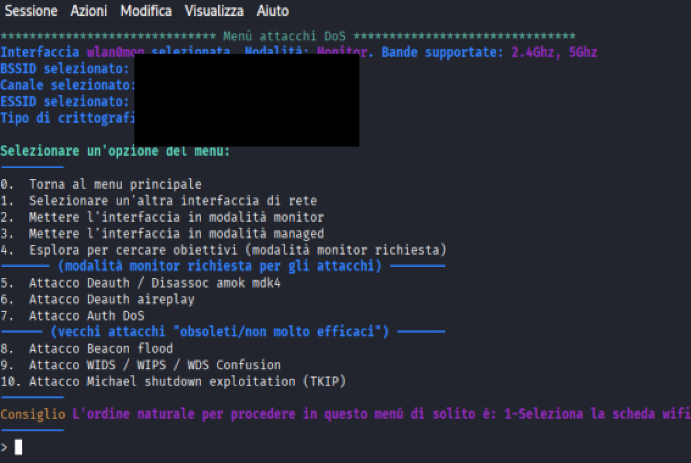
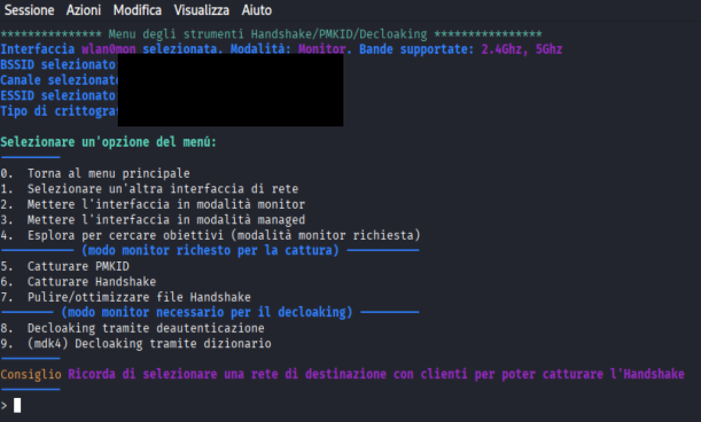

Airgeddon è uno script Bash open-source progettato per automatizzare e semplificare l'auditing di sicurezza delle reti Wi-Fi. Agisce come un *wrapper* attorno a strumenti ben noti come `aircrack-ng`, `airodump-ng`, `aireplay-ng` e altri, offrendo un'interfaccia guidata e interattiva.

Invece di eseguire manualmente molteplici comandi, Airgeddon consente di condurre complessi attacchi wireless passo dopo passo attraverso un flusso di lavoro basato su menu.

#### Panoramica del Menu Principale di Airgeddon

Ogni opzione in Airgeddon rappresenta una specifica fase o categoria di auditing Wi-Fi. Di seguito è riportata una breve descrizione di ciascuna azione disponibile.

0. **Exit the script** → Chiude Airgeddon e termina la sessione.

1. **Select another network interface** → Permette di cambiare adattatore di rete tra quelli disponibili (utile se sono collegate più schede Wi-Fi).

2. **Put interface in monitor mode** → Abilita la *monitor mode* per catturare frame 802.11 grezzi (necessaria per la maggior parte degli attacchi).

3. **Put interface in managed mode** → Ripristina la normale modalità Wi-Fi (*managed mode*) per riconnettersi alle reti.

4. **DoS attack menu** → Contiene tecniche di Denial-of-Service (ad esempio, *deauthentication flooding*).

5. **Handshake/PMKID/Decloaking tools** → Utilizzato per catturare handshake WPA/WPA2 o PMKID e rivelare SSID nascosti.

6. **WPA/WPA2 offline cracking menu** → Consente il cracking delle password utilizzando gli handshake o i PMKID catturati.

7. **Evil Twin attack menu** → Crea un falso access point per indurre gli utenti a connettersi e catturare potenzialmente le loro credenziali.

8. **WPS attack menu** → Include attacchi contro il protocollo WPS (ad esempio, brute force del PIN, Pixie Dust).

9. **WEP attack menu** → Attacchi legacy mirati alle reti WEP (oggi utili principalmente a scopo didattico).

10. **Enterprise attack menu** → Mira alle reti WPA/WPA2 Enterprise (ad esempio, raccolta di credenziali tramite *rogue AP*).

11. **WPA3 attack menu** → Contiene attacchi sperimentali o specifici relativi allo standard WPA3.

12. **Information & Credits** → Mostra informazioni sul progetto, collaboratori e ringraziamenti.

13. **Options and language menu** → Impostazioni di configurazione, preferenze dell'interfaccia e selezione della lingua.

#### Menu Attacchi DoS (Panoramica Pratica)

Prima di lanciare qualsiasi attacco in questa sezione, è necessario identificare una rete target.  
Questo si fa tramite l'opzione **4 (Explore for targets)**, che scansiona le reti Wi-Fi nelle vicinanze e permette di selezionare uno specifico access point (BSSID, canale, ESSID).

Una volta selezionato un target, diventano disponibili i seguenti attacchi:

5. **Deauthentication / Disassociation (mdk4)** → Esegue un attacco di deautenticazione ad alta velocità utilizzando `mdk4`. Forza i client connessi a disconnettersi dall'access point inviando frame di deautenticazione falsificati (*forged*). Viene spesso usato per catturare gli handshake WPA/WPA2 quando i client si riconnettono. Approfondisci [qui](/notes/deauthentication).

6. **Deauthentication (aireplay-ng)** → Simile all'attacco precedente, ma utilizza `aireplay-ng`. È più controllato e preciso, permettendo spesso di colpire singoli client specifici invece di inondare l'intera rete. Approfondisci [qui](/notes/deauthentication).

7. **Authentication DoS** → Invia un gran numero di false richieste di autenticazione all'access point, tentando di esaurirne le risorse. Questo può impedire agli utenti legittimi di connettersi.

Consiglio vivamente di testare questi attacchi **esclusivamente sulla propria rete** utilizzando contemporaneamente [Kismet](/notes/kismet) per avere un riscontro visivo di ciò che sta realmente accadendo nell'etere!

*(Attacchi più datati / meno efficaci)*

8. **Beacon Flood** → Genera un gran numero di falsi access point trasmettendo in broadcast frame *beacon* falsificati. Questo affolla l'ambiente Wi-Fi e può confondere gli utenti o gli scanner di rete.

9. **WIDS / WIPS / WDS Confusion** → Tenta di interferire con i sistemi di rilevamento e prevenzione delle intrusioni wireless generando pattern di traffico anomali o fuorvianti. In alcuni casi, questo crea una finestra temporale in cui è possibile eseguire un attacco reale mentre il sistema di difesa è distratto.

10. **Michael Shutdown Exploitation (TKIP)** → Prende di mira le reti che utilizzano il protocollo obsoleto TKIP. Sfruttando le debolezze nell'algoritmo Michael MIC, può innescare un blocco delle comunicazioni come meccanismo di difesa intrinseco del protocollo stesso. Tuttavia, TKIP è ormai deprecato: le reti moderne usano AES (CCMP) o WPA3 e molti dispositivi disabilitano TKIP per impostazione predefinita.

#### Attacchi di Decloaking (Deautenticazione vs Dizionario)

Gli attacchi di *decloaking* vengono utilizzati per rivelare le **reti Wi-Fi nascoste (hidden SSID)**.  
In queste reti, l'access point non trasmette il proprio nome nei frame *beacon*, facendolo apparire come `<hidden>` durante le scansioni. Tuttavia, l'SSID **non è realmente segreto**, poiché viene comunque trasmesso in chiaro durante la normale comunicazione tra i client e l'access point: "nascosto" NON significa "protetto".

**Decloaking tramite Deautenticazione (Opzione 8)**

1. Viene selezionata una rete target (BSSID + canale)  
2. L'attaccante monitora il traffico in attesa di client connessi  
3. Viene lanciato un attacco di deautenticazione  
4. I client sono costretti a disconnettersi  
5. Al momento della riconnessione, i client inviano richieste contenenti l'SSID  
6. L'attaccante cattura questi frame e rivela il nome della rete  

Questo metodo è **molto veloce e aggressivo**, quindi rumoroso e facilmente rilevabile, ma rimane comunque il più efficace.

**Decloaking tramite Dizionario (Opzione 9)**

1. L'attaccante cattura il traffico di *probe* / associazione  
2. Viene utilizzata una wordlist (dizionario) di possibili SSID  
3. Il tool confronta i dati catturati con i possibili SSID presenti nella lista  
4. Se viene trovata una corrispondenza, l'SSID nascosto viene rivelato  

In alcuni casi:
- Sfrutta specifici pattern presenti nei frame catturati  
- Oppure correla il comportamento dei client con SSID già noti  

Questo metodo è **passivo e silenzioso (stealth)**, di conseguenza più lento, meno affidabile e strettamente dipendente dalla qualità del dizionario utilizzato.

---

Restate sintonizzati per i prossimi aggiornamenti...