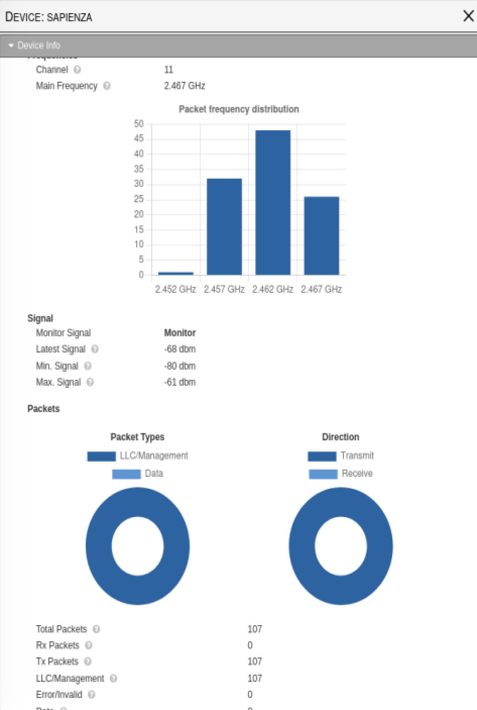

[Kismet](https://www.kismetwireless.net/docs/readme/logging/logging/) è uno sniffer open-source, un sistema WIDS (*Wireless Intrusion Detection System*), uno strumento di wardriving e di cattura pacchetti per Wi-Fi, Bluetooth, BLE (BTLE), termometri wireless, aeromobili (ADS-B), contatori intelligenti, Zigbee e molto altro.

Opera quasi interamente in modo passivo, salvo rare eccezioni, e in generale non è uno strumento offensivo.

È possibile utilizzare Kismet per la ricognizione passiva e per individuare reti deboli o mal configurate, ma anche per monitorare attività sospette all'interno della propria rete e supportare attività come il wardriving. Rispetto ad `airodump-ng` è molto più intuitivo e completo: diamogli un'occhiata!

## 🖥️ Interfaccia Web di Kismet – Panoramica Home

L'immagine mostra la dashboard principale di Kismet, accessibile tramite la sua interfaccia web, che raccoglie e visualizza in tempo reale tutta l'attività wireless rilevata grazie alla *monitor mode*.

Nella parte superiore sono presenti diverse schede come **Alerts, SSIDs e ADSB live**, che consentono di passare rapidamente tra le varie tipologie di informazioni raccolte da Kismet.

La sezione principale della pagina è costituita da una tabella che elenca tutte le reti wireless rilevate (Access Point). Per ciascuna rete, Kismet fornisce dettagli utili come:

- **Type** → tipologia del dispositivo rilevato (es. Access Point)  
- **PHY** → standard wireless utilizzato (come IEEE 802.11)  
- **Encryption** → protocollo di sicurezza adottato (WPA2, WPA3, ecc.)  
- **Signal (Sgn)** → intensità del segnale, utile per stimare la vicinanza della rete  
- **Channel (Chan)** → canale radio utilizzato  
- **Data / Packets** → quantità di traffico catturato  
- **Clients** → numero di dispositivi connessi  

Ogni riga rappresenta una rete rilevata e la tabella si aggiorna continuamente man mano che vengono individuati nuovi dispositivi o cambia l'attività di rete.

## 🚨 Kismet Alerts – Rilevamento delle Minacce in Tempo Reale

L'immagine mostra il **pannello Alerts di Kismet**, che mette in evidenza una delle sue funzionalità più potenti: la capacità di rilevare attività sospette e potenziali attacchi in tempo reale.

In questo caso, possiamo osservare molteplici avvisi relativi a eventi di **deautenticazione/disassociazione broadcast (BCASTDISCON)** che ho eseguito utilizzando il firmware Bruce.  
L'aspetto fondamentale è che gli alert vengono generati **immediatamente**, non appena il comportamento anomalo viene osservato nell'etere.

Inoltre, il pannello mostra avvisi legati al sistema stesso (come l'esecuzione di Kismet con privilegi di `root`), utili per migliorare la consapevolezza sia in termini di **sicurezza sia di configurazione**.

L'immagine fornisce maggiori dettagli su come è stato condotto l'attacco DoS: il firmware Bruce esegue infatti un *Deauth Attack* falsificando (*spoofing*) l'indirizzo MAC dell'Access Point.

---

## Informazioni sull'Access Point

L'immagine mostra le informazioni principali relative a un Access Point (AP) rilevato:

- **SSID** → il nome della rete  
- **BSSID (indirizzo MAC)** → identificativo univoco dell'AP  
- **Manufacturer** → produttore ricavato dall'indirizzo MAC (tramite lookup OUI)  
- **Channel** → il canale Wi-Fi in uso  
- **Frequency range** → ad esempio, il canale 11 copre tipicamente l'intervallo da **2452 MHz a 2472 MHz**

Il **grafico a barre** rappresenta la distribuzione dei pacchetti lungo le frequenze del canale.  
Ogni canale Wi-Fi corrisponde a un **intervallo di frequenze** e il grafico mostra dove si concentra l'attività del segnale all'interno di tale spettro. Talvolta è possibile notare anche attività proveniente dai **canali adiacenti**, a causa della sovrapposizione delle frequenze (*overlapping*).

Per comprendere meglio questo concetto:

- Il **canale** = l'intera autostrada  
- Le **frequenze** = le corsie  
- I **pacchetti** = le automobili  

I pacchetti non occupano una singola frequenza fissa, ma vengono distribuiti lungo tutto il canale in base alla trasmissione. Questo comportamento è dovuto alla modulazione **OFDM (Orthogonal Frequency Division Multiplexing)**, in cui i dati vengono suddivisi su più sottoportanti (*subcarriers*).

Il **grafico a ciambella** etichettato **Packet Types** mostra invece la natura del traffico catturato:

- **Management / LLC**
  - Beacon frame  
  - Probe request / response  
  - Frame di autenticazione  
- **Data**
  - Traffico dati reale degli utenti (navigazione web, applicazioni, ecc.)

---

## Comportamento dell'SSID

#### Advertised SSID

- Il nome della rete trasmesso attivamente in broadcast dall'AP  
- Inviato tramite **beacon frame**  
- Visibile durante la scansione passiva  

#### Responded SSID

- Il nome della rete restituito quando un client cerca attivamente le reti disponibili  
- Inviato tramite **probe response frame**  

Questa distinzione mette in luce la differenza tra:
- rilevamento passivo (*passive discovery*)  
- sondaggio attivo (*active probing*)  

#### Funzionalità di Sicurezza: MFP

L'**MFP (Management Frame Protection)** protegge i *management frame* da alterazioni e falsificazioni.

- Se **abilitato** → protezione garantita contro determinati attacchi  
- Se **non disponibile** → la rete rimane vulnerabile  

Ad esempio, l'assenza di MFP espone la rete ad attacchi come:
- **attacchi di deautenticazione**

#### Ampiezza del Canale (HT Mode)

La modalità **HT (High Throughput)** indica la larghezza di banda del canale:

- **HT20** → 20 MHz  
- **HT40** → 40 MHz  

Canali più ampi consentono un throughput maggiore, ma aumentano il rischio di interferenze.

#### WiFi Bridging

Quando un dispositivo viene contrassegnato come **WiFi Bridged**, significa che:

- non opera come un semplice client  
- agisce come un **bridge tra due reti**

Questo scenario si verifica, ad esempio, nel caso di:
- ripetitori (*repeater*)  
- hotspot  
- dispositivi di routing  

