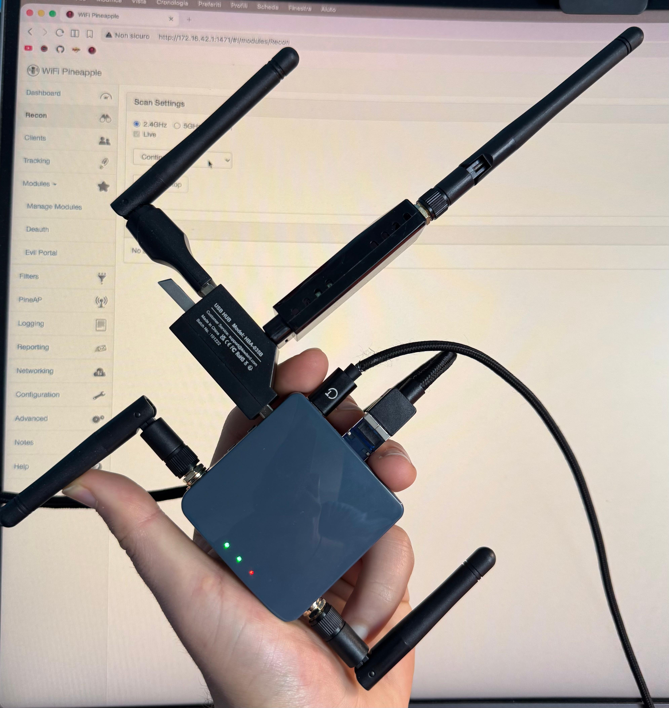

Questa è una delle cose più interessanti che vedrai mai: il mio primo e nuovissimo **WiFi Pineapple** fatto in casa, realizzato per i miei test di penetrazione Wi-Fi e molto altro.

Di seguito riporto i link che mi sono stati d'aiuto:

- [GitHub](https://github.com/SHUR1K-N/WiFi-Shadowapple-Resources)
- [Build](https://www.youtube.com/watch?v=67sGUzKJ8IU)
- [Boost](https://www.youtube.com/watch?v=pHtpso21P0o)

Consiglio vivamente di leggere e guardare con attenzione ogni singolo dettaglio del repository e dei video, specialmente per quanto riguarda l'hardware da acquistare prima di iniziare l'assemblaggio.

Non ho trovato questo progetto affatto difficile, soprattutto perché tutto è spiegato in modo chiaro, costantemente aggiornato e continuamente migliorato con nuovi moduli e funzionalità.
