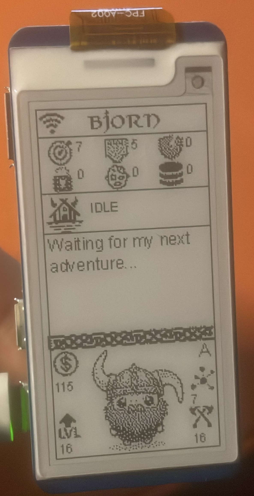
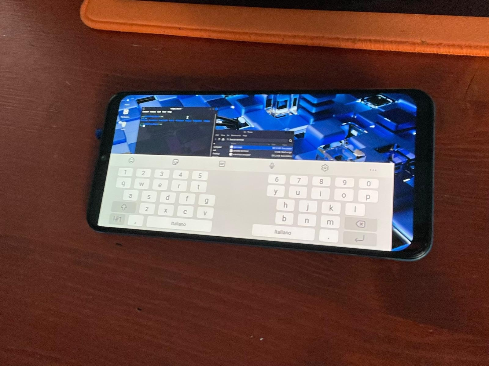
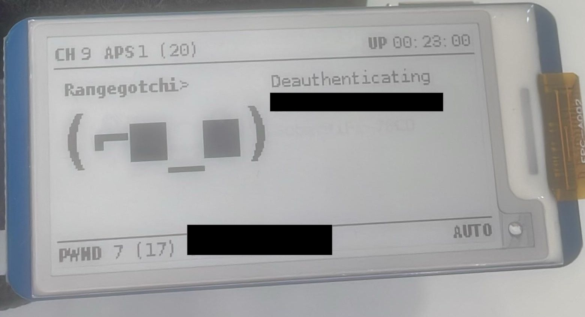
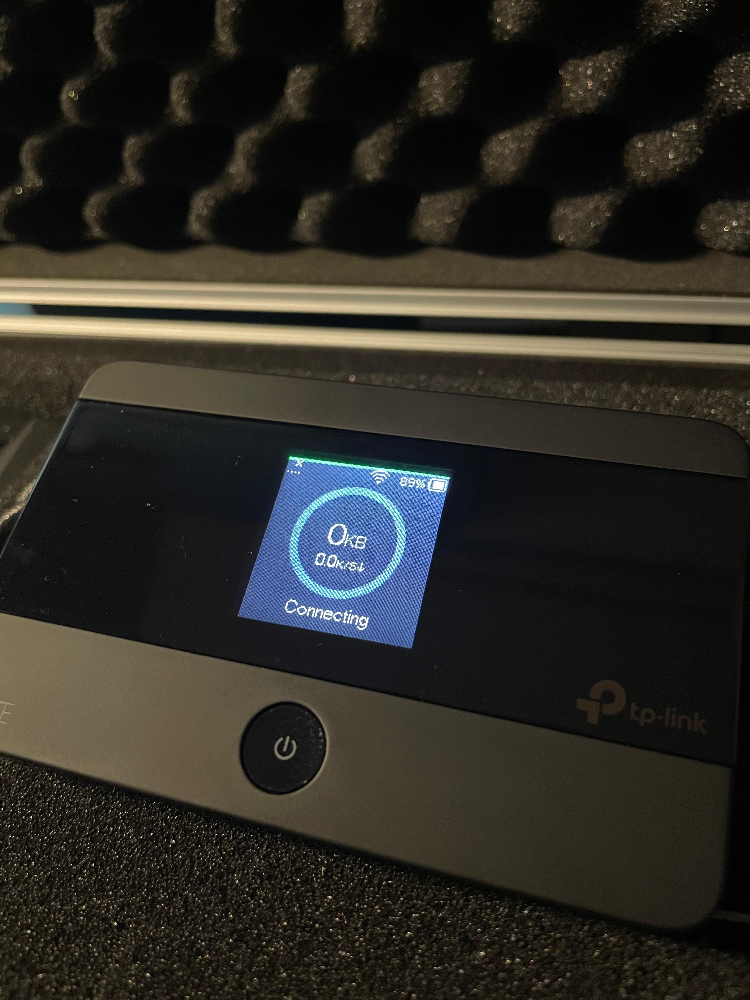
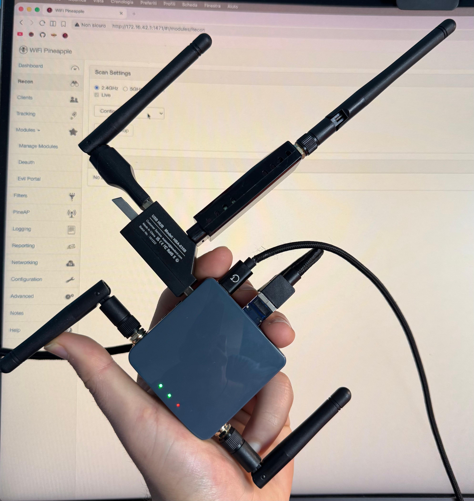
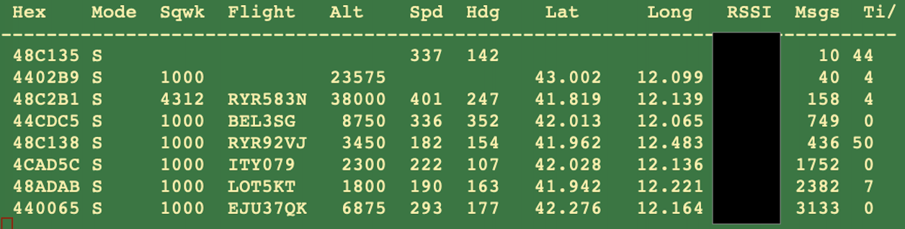
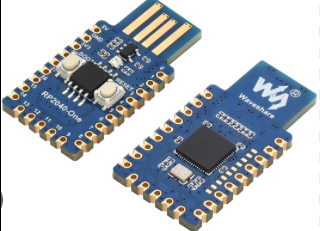
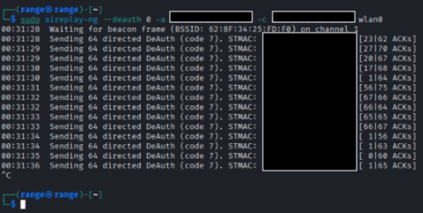

Questa pagina raccoglie i progetti extra universitari a cui mi sono interessato:

  <a href="/projects/Bjorn/" style="text-decoration: none; color: inherit; text-align: center; width: 200px;">
    
    
Bjorn ☃️

  </a>

  <a href="/projects/Bruce/" style="text-decoration: none; color: inherit; text-align: center; width: 200px;">
    
    
Bruce 🦈

  </a>

  <a href="/projects/HomeLab/" style="text-decoration: none; color: inherit; text-align: center; width: 200px;">
    
    
Home Lab 🦇

  </a>

  <a href="/projects/netHunter/" style="text-decoration: none; color: inherit; text-align: center; width: 200px;">
    
    
Kali NetHunter 🐉

  </a>

  <!--
  <a href="/projects/Pi_Hole/" style="text-decoration: none; color: inherit; text-align: center; width: 200px;">
    
    
Pi Hole 🛡️

  </a>
  -->

  <a href="/projects/Pwngotchi/" style="text-decoration: none; color: inherit; text-align: center; width: 200px;">
    
    
Pwnagotchi 🧸

  </a>

  <a href="/projects/Rayhunter/" style="text-decoration: none; color: inherit; text-align: center; width: 200px;">
    
    
Rayhunter 🦈

  </a>

  <a href="/projects/Shadow_Apple/" style="text-decoration: none; color: inherit; text-align: center; width: 200px;">
    
    
Shadow Apple 🍎

  </a>

  <a href="/projects/Software_Defined_Radio/" style="text-decoration: none; color: inherit; text-align: center; width: 200px;">
    
    
Software Defined Radio ✈️

  </a>

  <a href="/projects/Usb_Killer/" style="text-decoration: none; color: inherit; text-align: center; width: 200px;">
    
    
USB Killer 🗡️

  </a>

  <a href="/projects/WPA2_Deauthentication/" style="text-decoration: none; color: inherit; text-align: center; width: 200px;">
    
    
WPA2 Deauthentication 👾

  </a>

